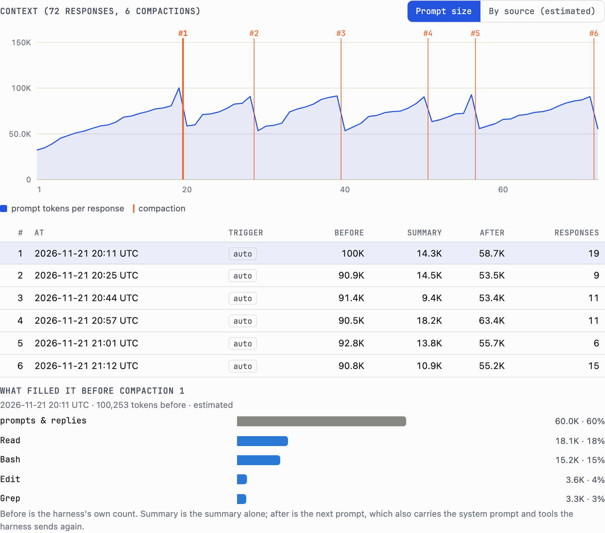

# Context compaction in Claude Code and Codex

A coding agent sends the model the whole conversation on every response, so the context only grows. When it nears the model's limit, the harness has the model summarise the session and carries on from the summary. That is a compaction. It decides what the agent still knows about the work so far, and it happens without much notice.

agent-top 0.30 draws the context of every session as a timeline, with each compaction marked. This post covers how compaction works, how Claude Code and Codex differ in doing it, and what the timeline shows.

<!-- more -->

## Why the context only grows

A model keeps no state between requests. For each response the harness sends everything again: the system prompt, the tool definitions, memory files such as `CLAUDE.md` or `AGENTS.md`, every message, and every tool result still in the conversation. A file the agent read on its third response is sent again on the fourth, the fortieth and every response after, until something removes it.

So the prompt size of a session climbs with each response, and each step up is whatever was added since the last one: a reply, a tool result, a message of yours. Every token in it is paid for again on each response, at the cache-read price when the prompt cache holds and at the full input price when it does not. [Context by source](../../accounting.md#context-by-source) shows that cost per tool.

The climb ends at the model's context window. Before it gets there, the harness compacts.

## What a compaction does

Every harness does roughly the same thing:

1. Send the conversation to the model with an instruction to summarise it: what the task is, what has been done, what was decided, what is left.
2. Replace the conversation with that summary.
3. Continue, sending the fixed parts (system prompt, tools, memory files) plus the summary.

After a compaction the agent works from the summary. Exact tool output, the reasons behind earlier decisions and files it read early on are gone unless the summary kept them. The harnesses differ in when they do this, what they keep beside the summary, and what they write down.

## Claude Code

According to [its docs](https://code.claude.com/docs/en/model-config.md#default-auto-compact-thresholds), Claude Code compacts on its own when the conversation reaches the model's context limit. A model with a 1M window compacts before it fills, at about 967K tokens by default. The `autoCompactWindow` setting or the `/autocompact` command sets a different point, and `CLAUDE_AUTOCOMPACT_PCT_OVERRIDE` can lower it to a percentage of that window. `/compact` asks for one by hand and takes optional instructions on what the summary should focus on. `/context` shows how full the context is.

[What survives a compaction](https://code.claude.com/docs/en/context-window.md#what-survives-compaction): the system prompt and output style still apply, the project's `CLAUDE.md` and auto memory are read again from disk, and up to five recently changed files are re-read. `PreCompact` and `PostCompact` [hooks](https://code.claude.com/docs/en/hooks.md#precompact) run around it, with the trigger as `manual` or `auto`.

It records each compaction in the session's transcript, a JSONL file under `~/.claude/projects`. A `system` line with `subtype: "compact_boundary"` carries `compactMetadata` with the trigger (`auto` or `manual`), `preTokens` (the context size before) and `postTokens`, followed by the summary itself as a `user` line marked `isCompactSummary`.

From the 32 Claude Code sessions on the machine this post was written on:

- 17 compacted at least once, 60 times in all, every one of them automatic.
- The size before ranged from 200k to 968k tokens, the two documented thresholds. The same model id runs with a 200k or a 1M window, and the transcript does not say which.
- `postTokens` is the summary alone. The first prompt after a compaction was about four times it (median 66.8k against a 16.9k summary), because the system prompt, tools and memory files are sent again with it.

## Codex

Codex's compaction is in its open source, `codex-rs/core/src/compact.rs` (read at `rust-v0.171.0`). It compacts automatically once the context reaches 90% of the model's window, or earlier if `model_auto_compact_token_limit` in its [config](https://learn.chatgpt.com/docs/config-file/config-reference) is lower. `model_post_turn_compact_threshold_percent` makes it compact at the end of a turn instead of mid-turn, and `/compact` asks for one by hand. `/status` shows the context left.

The summary prompt asks for "a handoff summary for another LLM that will resume the task": progress and decisions, constraints and user preferences, what remains, and any data needed to continue. The new history is not the summary alone. Codex keeps your most recent messages, up to about 20,000 tokens of them, and adds the summary after them, prefixed with a note that "another language model started to solve this problem and produced a summary of its thinking process". `compact_prompt` in the config replaces the summary prompt.

Codex writes the model's window into every session as `model_context_window`, after taking 5% off as headroom. The sessions agent-top has seen say 258,400, which is 95% of 272,000; automatic compaction comes at 244,800. The source also writes a `compacted` line with the summary when it compacts. None of the 132 Codex sessions on this machine has one yet, so agent-top does not read it until it has a real one to test against.

## Side by side

| | Claude Code | Codex |
|---|---|---|
| Automatic | at the context limit (about 967K on a 1M window), or `autoCompactWindow` | at 90% of the window, or `model_auto_compact_token_limit` |
| By hand | `/compact [instructions]` | `/compact` |
| Summary prompt | focus instructions on `/compact` | replaceable with `compact_prompt` |
| Kept beside the summary | system prompt, tools, `CLAUDE.md` and memory, up to five recent files | system prompt, tools, its rebuilt initial context, your recent messages up to about 20k tokens |
| Recorded | a boundary line with trigger, size before and summary size | a `compacted` line with the summary (none seen yet) |
| Window in the transcript | no | yes, `model_context_window` |

OpenCode records its compactions as a summary message. Gemini CLI has no compaction record that agent-top has seen. Kodelet stores only the context's current size, so it has no timeline.

## What agent-top shows

agent-top reads each response's prompt size from the transcript and draws it, one point per response. Press `c` on a session in the live view, or open a session in `agent-top ui`:



A compaction the harness recorded is a solid rule, and the table under the chart gives its trigger, the size before, the summary size, the first prompt after, and how many responses it took to fill. When the harness recorded nothing, as with Codex today, a prompt that falls below half its previous size is marked as an inferred compaction with a dashed rule. Nothing else shrinks a prompt that much. When the harness writes the window, a dotted line marks it.

Three things are worth looking for:

- **Steep steps.** One tool result that added tens of thousands of tokens. It is re-read on every response until the next compaction, so a narrower read pays for itself.
- **The floor after each compaction.** The first prompt after is the fixed cost of every response. A high floor means large memory files or many MCP tool definitions, and it leaves less room before the next compaction.
- **Compactions close together.** A stretch that fills in a handful of responses means the agent keeps working from summaries of summaries. A fresh session or a subagent is usually the better tool.

Each subagent starts from an empty context and gets its own timeline: `Tab` in the live view, or the Agent list in the web view. `agent-top sync` keeps all of it in the local store, so you can query compactions across sessions with `agent-top sql`.

[Reading the context timeline](../../context-timeline.md) has the full key, with each mark, each column and each shape.

## Try it

```sh
brew upgrade agent-top     # or: cargo install agent-top
agent-top                  # select a session, press c
agent-top sync && agent-top ui
```

The first `sync` after upgrading re-reads every transcript to fill the new tables, so it takes longer than usual.
