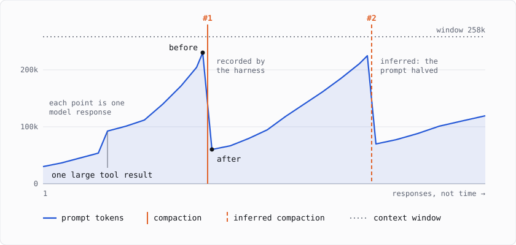

# Reading the context timeline

The context timeline shows how much a coding agent re-read at every model response in a session, and where the harness cut it back.

It is in two places:

- In the live view, select a session and press `c`. `s` splits the line by source, `Tab` steps to a subagent, `Esc` closes it.
- In `agent-top ui`, open a session. The chart is at the top of the session panel.

<video src="../context-demo.mp4" controls muted playsinline preload="metadata" width="100%" aria-label="A walk through the context timeline in agent-top ui: the prompt line, a compaction and what filled it, the by-source split, a subagent's timeline, and a Codex session with its context window"></video>

## What one point is

Each point is one model response. Its height is the prompt that response read: the system prompt, the tool definitions, memory files, and the whole conversation so far, including every tool result still in it. The harness sends all of it again on every response, so the line climbs as the session goes on and never falls by itself.

The x axis counts responses, not time. An hour away from the keyboard takes no width.

{ .bare }

| Mark | Meaning |
|---|---|
| Blue line | Prompt tokens at each response, as the harness reported them. |
| Steep step | A lot of text entered the context at once, usually one large tool result: a whole file read, a long command output, a big MCP response. |
| Solid rule | A compaction the harness recorded. The number above it matches the row in the table. |
| Dashed rule | A compaction the harness did not record: the prompt fell below half its previous size between two responses. Its trigger shows as `inferred`. |
| Dotted line | The model's context window, drawn only when the harness writes it (Codex and Kodelet). |

## A compaction

When the context gets close to the model's limit, the harness asks the model to summarise the conversation, then starts again from that summary. The line drops, then climbs again from the new floor. A long session looks like a saw.

The table under the chart has one row per compaction:

| Column | Meaning |
|---|---|
| `#` | The rule's number on the chart. |
| at | When it happened, in UTC. |
| trigger | `auto` when the harness compacted on its own, `manual` when you asked (`/compact`), `inferred` when agent-top found it from the drop. |
| before | The context size just before, in the harness's own count. |
| summary | The size of the summary alone. Claude Code records it. |
| after | The prompt of the first response after the compaction. |
| responses | How many responses the stretch before it ran. |

**After** is several times **summary**. The summary replaces the conversation, but the next response also carries the system prompt, the tool definitions and memory files again. On real Claude Code sessions the first prompt after was about four times the summary. The gap is the fixed part of every prompt. The line cannot drop below it.

Below the table, the web view shows what filled the context before the selected compaction, as bars per tool. The live view gives the two largest tools in each row.

## By source

`s` in the live view, or **By source (estimated)** in the web view, splits the line into tool results, MCP results, and prompts and replies. The split is an estimate: agent-top sizes each tool result by how much the next prompt grew, and splits evenly when several results arrived together. The total is exact. [Accounting](accounting.md#context-by-source) has the method.

## The window line

The window line appears only when the harness wrote the model's window into the session. Codex does (258,400 tokens on the sessions checked). Claude Code does not, and agent-top does not look the window up by model name, because the same model id can run with a 200k or a 1M window. When the window is known, the live view gives the context as a share of it, such as `120k now of 258k (46%)`, and the web view's tooltip does the same.

## Subagents

A subagent starts from an empty context, so each has its own timeline. In the live view `Tab` steps through them in start order, and the title names the one shown. In the web view, the **Agent** list above the chart switches between them. A subagent's line is usually short and rarely compacts.

## Shapes to look for

| You see | It means | What you can do |
|---|---|---|
| Steep steps | Single tool results that added tens of thousands of tokens. Every later response re-reads them until the next compaction. | Ask for narrower reads: a line range, `grep`, `head`, a filtered command. |
| Compactions a few responses apart | Each stretch fills quickly, so the agent keeps losing detail to summaries. | Start a fresh session for the next task, or split the work across subagents. |
| A high floor after every compaction | The fixed part of the prompt is large: system prompt, tools, memory files, MCP tool definitions. | Remove MCP servers the session does not use, and trim large memory files. |
| A long climb close to the window | The next compaction is near. | Compact by hand at a good stopping point, so the summary covers a finished step. |
| A dashed rule | The harness did not record the compaction. Its trigger and summary size are unknown. | Read it as a compaction. |
| No line at all | The harness keeps no size per response (Kodelet shows the current size only), or the session was synced by an agent-top older than 0.30. | Run `agent-top sync` again while the transcript is still on disk. |

## Which harnesses

| Harness | Line | Compactions | Window |
|---|---|---|---|
| Claude Code | yes | recorded, with trigger and summary size | no |
| Codex | yes | inferred | yes |
| OpenCode | yes | recorded | no |
| Gemini CLI | yes | inferred | no |
| Kodelet | current size only | none | yes |

## In the store

`agent-top sync` keeps every point and compaction in the local store, in the `context_points`, `compactions` and `compaction_sources` tables ([Schema](store/schema.md)). For example, the sessions that compacted most this month:

```sql
select harness, session_id, count(*) as compactions
from compactions
where agent = ''
  and at >= unixepoch('now', 'start of month') * 1000
group by 1, 2 order by 3 desc limit 10;
```
