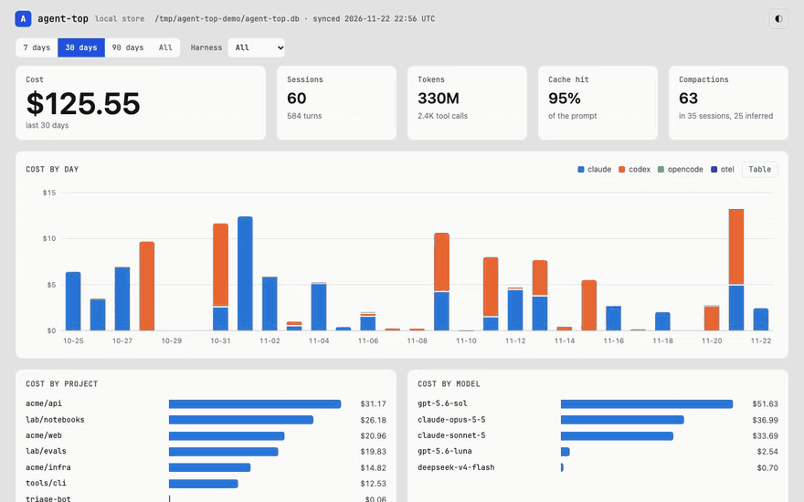
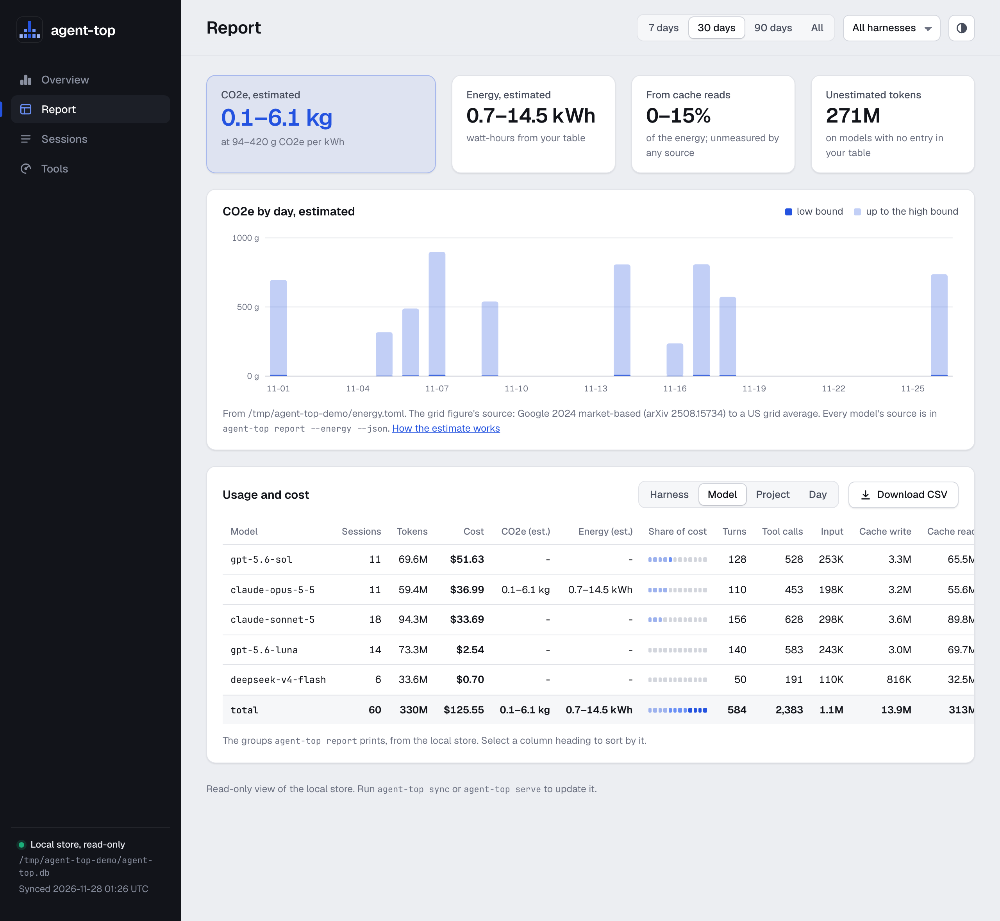
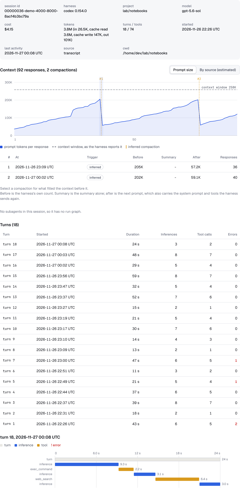
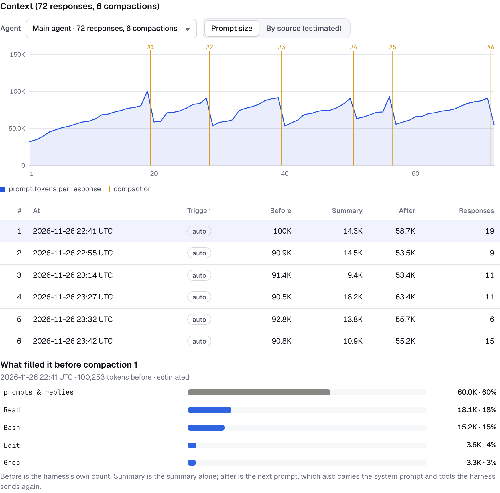
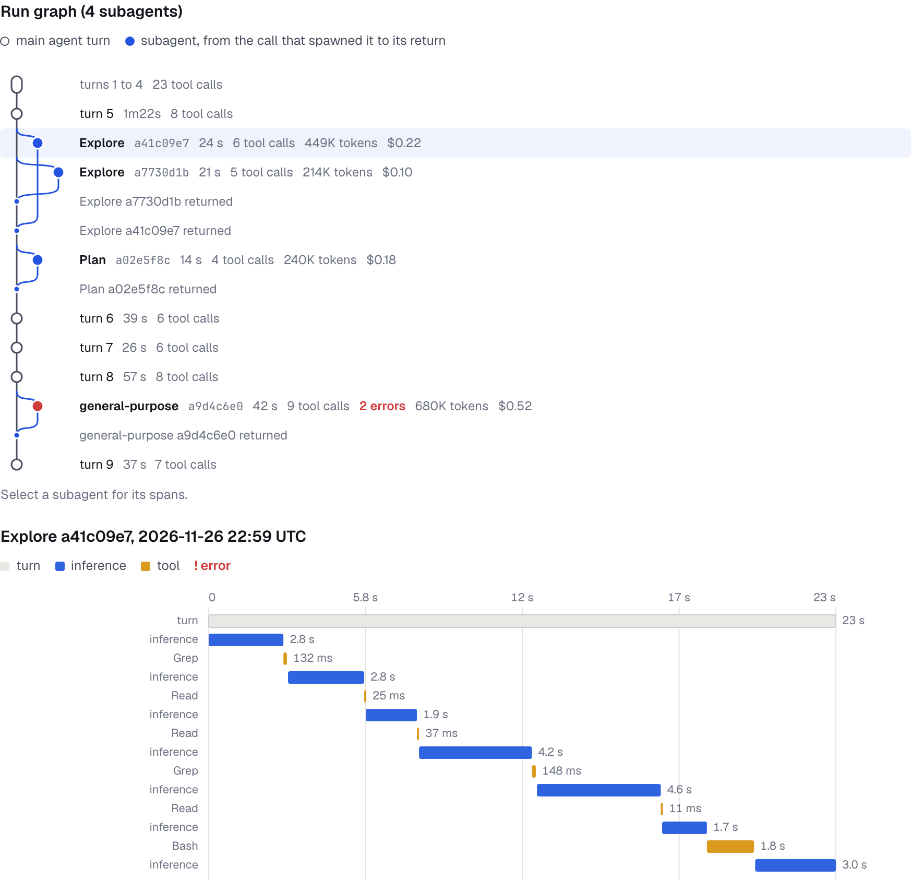

# Web view

`agent-top ui` serves a web page of the [local store](index.md) on this machine.

```sh
agent-top ui                         # http://127.0.0.1:4320/
agent-top ui --addr 127.0.0.1:8080   # another port
agent-top ui --db ./mine.db          # another store
```

Open the address it prints in a browser. To try the page without installing anything, open the [demo](../demo/index.html): the same page, on a made-up store.




The page has four tabs: **Overview**, **Report**, **Sessions** and **Tools**. The range (7, 30 or 90 days, or all) and the harness filter sit under the tabs and apply to every tab.



| Tab | Section | What it shows |
|---|---|---|
| Overview | Totals | cost, sessions, tokens, cache hit and unpriced tokens for the range, and how many compactions there were |
| Overview | Cost by day | one column per day, stacked by harness; **Table** shows the same numbers as rows |
| Overview | Cost by project, cost by model | the ten most expensive |
| Report | Report | one row per harness, model, project or day, the groups `agent-top report` prints: sessions, turns, tool calls, input, cache write, cache read, output, tokens, cache hit, cost and unpriced tokens, with a total row; select a heading to sort, **CSV** to download the rows |
| Report | CO2e and energy | with an [energy table](../energy.md): the estimate's totals, its share from cache reads, CO2e by day from its low to its high bound, and CO2e and energy columns in the report; without one, how to add it |
| Tools | Tool latency | calls, errors, p50, p95 and the longest call for each tool |
| Tools | MCP servers | calls and errors per server, when any session used one |
| Sessions | Sessions | the 200 most recent, with a count on those that ran subagents; select one for its detail |
| Sessions | Session detail | in a panel on the right: its facts, its context timeline, its turns with duration, tool calls and errors, and a waterfall of the spans in the selected turn |
| Sessions | Context timeline | the prompt each model response read, with a rule at each compaction, a table of the compactions, and what filled the context before the selected one |
| Sessions | Run graph | in a session that used subagents: the main agent's turns as a trunk, and each subagent as a branch from the call that spawned it to its return |







The run graph reads top to bottom in time order. Rows are evenly spaced, so a session idle for a day takes no more room than a busy one, and turns with no subagent between them fold into one row. Two branches side by side ran at the same time. Each branch shows the subagent's type, how long it ran, its tool calls and errors, and its tokens and cost; selecting it shows its spans as a waterfall, and the first subagent is selected when the session opens. The join between a subagent and the call that spawned it is the harness's own record, and a subagent without one is drawn with a dashed line. Claude Code and OpenCode sessions have this today.

The context timeline counts responses along the bottom, not time, for the same reason. The line and the compactions are the harness's own numbers. **By source (estimated)** splits the line into tool results, MCP results and prompts and replies, the same estimate as the live view's context sources. A dashed line across the chart is the model's context window, drawn only when the harness wrote it (Codex). A dashed rule is a compaction the harness did not record: the prompt fell below half its previous size. The summary column is the summary's own size; the after column is the next prompt, which also carries the system prompt and tools, so it is several times larger. The timeline is the main agent's. In a session with subagents, an **Agent** list above the chart switches to a subagent's own timeline. A session synced by an older agent-top gets one at the next `sync`, while its transcript is still on disk. [Reading the context timeline](../context-timeline.md) explains each mark.

Each harness keeps one colour everywhere. A session's detail opens beside the sessions table, which marks the open row, so another session is one click away; `Esc` or **Close** shuts it. It has its own address (`#s/<harness>/<id>`), so it can be reopened or bookmarked. So does each tab (`#report/model`, `#sessions`, `#tools`; the overview has none), and the browser's Back button steps through them. Switching tabs closes the session panel. Opening the page with no address returns to the tab last used.

Each request reads the store afresh, so reloading the page shows the latest `sync` or received telemetry. The view opens the store read-only and cannot change it.

The images, the recording and the demo come from a made-up store that `docs/ui-demo.py` builds; they show no real sessions.

## Who can open it

It listens on `127.0.0.1` unless `--addr` names another address, so only this machine can reach it. It answers only `GET`, and refuses a request whose `Host` header is not its own address or `localhost` on its port, which stops a web page in another tab from reading it under a different name. The page, its script and stylesheet are built into the binary; it loads nothing from anywhere else, and its Content-Security-Policy forbids it.
